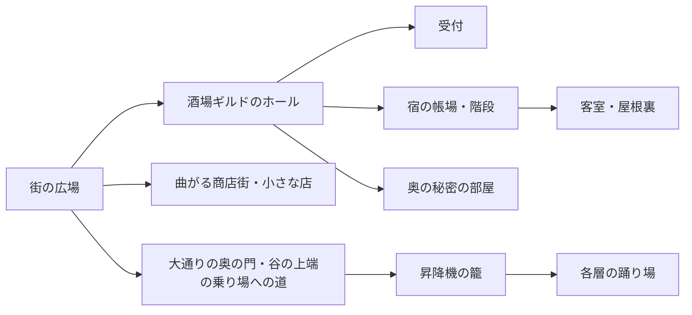

---
{
  "entity": "[[concept/lore/world/world-space-camera.json]]"
}
---

# 空間とカメラの共通設計

## 設計の目的

街と同じ世界の、実際に人が使える場所を作る。太い黒線、大きな色面、網点、角張った魚眼の遠近を共通にする。室内の暖色と外の青い夜はつながるが、洞窟の青緑、墓場の灰紫、鉄橋の錆、温室の濁った緑、祭壇の赤紫は場所の違いとして残す。全部を同じ色に塗ることを統一としない。

以下の寸法・配置は、画像を作る前に矛盾を見つけるための制作案。実測値や確定した建築設定ではない。人物の来歴、部屋数、宿泊人数のゲーム規則、施設機能を追加するものではない。

## 線・塗り・描き込みの共通基準

街は色調・建築・魚眼の構図の参照にする。線と面の描き方は、アルダとマユの通常上半身、ブリックトードと結晶モグラの通常画像を比較基準にする。この4点の実画像を照合すると、人物・敵は太い輪郭、大きなベタ面、限られた影の領域に置く網点が中心。背景の試作には細い材質線と全面的な粒状テクスチャが多く、同じ絵柄としてまだ揃い切っていない。全キャラ・全状態画像の一致を確認したことにはしない。

| 要素       | 背景でも合わせる描き方                                         | 現状から整理するもの                                                 |
| ---------- | -------------------------------------------------------------- | -------------------------------------------------------------------- |
| 輪郭       | 大きな形を太い黒線で区切り、内部線は必要な構造だけに使う       | 木目・石の傷・金属の細かな線を輪郭と同じ密度で増やさない             |
| 塗り       | 材質の形に沿う少数の大きなベタ面                               | ブラシのまだら、擦れ、細かな三角形、なめらかな陰影を面全体へ重ねない |
| 網点       | 影の一部を境界の分かる網点の面にする                           | 紙の粒や砂状ノイズを画面全体へ掛けて網点の代わりにしない             |
| 描き込み   | 入口・机・梁など、用途と空間が読める構造を優先する             | 全ての板・石・屋根瓦に個別の模様や傷を描かない                       |
| 密度と距離 | 手前・中景・奥で細部を減らし、人物が重なる中景は大きな面を残す | 遠くの棚・窓・小物まで同じ精度で描いて画面を埋めない                 |

背景には人物より多くの物があるため、物の数まで同じにする必要はない。ただし一つの木の梁、一枚の布、一つの石の描き方は、人物の衣服や敵の体と同じ面の整理に合わせる。網点の粒径・輪郭の太さは素材の元解像度のピクセル数だけで固定せず、実画面で人物と背景を重ねた見え方で比較する。

魚眼の迫力は形の遠近・前景の重なり・カメラ角度で残す。描き込みを減らした結果、構図まで平坦にしない。街の画像にも同じ基準で密度を照合し、街にある細かな質感をすべての背景へ複製することを統一の条件にしない。

## 実寸と映り方を分ける

先に平面と高さを決め、その空間の中へカメラを置く。レンズを変えても寝台の実寸や扉の高さは変わらない。手前の寝台が大きく迫るのはよい。同じ距離の椅子より何倍も高い寝台や、奥行きの足りない場所に押し込まれた家具は修正する。

| 基準物                 | 歪みを掛ける前の制作目安                                   | 確認する関係                                           |
| ---------------------- | ---------------------------------------------------------- | ------------------------------------------------------ |
| 通常体格の大人         | 身長約1.7m                                                 | 小柄な種族も大人。人物の体格を室内に合わせて変更しない |
| 入口                   | 高さ2.1m、幅0.9〜1.2m                                      | 枠・壁厚・扉の開く場所と歩く場所を確保                 |
| 椅子・食卓             | 座面0.45m、天板0.75m                                       | 足が収まり、座った人が卓上を使える                     |
| 帳場・酒場のカウンター | 天板0.95〜1m                                               | 普通の椅子と区別。高い腰掛けは座面約0.7m               |
| 一人用寝台             | 長さ2.1m、幅0.9〜1m                                        | 枕・荷物で寝る長さを削らない                           |
| 階段                   | 蹴上げ0.16〜0.18m、踏面0.26〜0.3m                          | 上階3mには約18段と約4.8mの水平距離。折り返しも配置する |
| 通路・手すり           | 一人用0.9m以上、二人が通る主動線1.2m以上、手すり高さ1m前後 | 袋や扉、椅子を引いた場所まで含めて通れる               |
| 手持ちの物             | コップ0.12m、薬瓶0.1〜0.25m、灯り0.2〜0.3m                 | 台・手・棚に対して扱える大きさ                         |

室内は主動線を入口から奥まで一本つなぎ、家具の使用範囲と扉の開閉範囲を別に取る。寝台の数だけを並べて部屋が成立したことにしない。段差は理由のある場所だけに置き、すべての店に舞台のような小階段を足さない。

## 街から施設へ続く空間

街の絵の左は大きな酒場ギルド、右は普通の町家の並び。中央の大通りが奥へ通り、突き当たりの右寄りに街の外へ旅立つ門が遠景で見える。門の先の道は街はずれの乗り場へ向かう。宿はギルドの建物の中にあり、ホールの左奥の帳場と階段から上階の客室と屋根裏へ上がる。ギルドのホールの正面奥に受付、奥の壁に秘密の部屋の扉がある。街はずれは谷の上端。籠で降りた先が各層の踊り場で、鉄橋は谷に昔からある別の橋。

ギルドの外形は幅18m×奥行14m程度を検討基準にし、宿の帳場・階段・客室もこの中に収める。門の通路は幅3m・高さ4m程度。街の絵に描かれた張り出す上階・屋根を保ち、外観を小さく見積もって内装だけ巨大にしない。商店街の各店は幅6〜8m程度。室内で見えていない奥行きや倉庫まで、勝手に新しい施設として確定しない。

## 映画の一場面としてのカメラ

メイン背景は、街と同じ強い魚眼・広角の迫力を基本にする。画角は12〜16mm相当を構図の言葉として使えるが、数値だけで決めず、主役・床の見える量・手前の輪郭を指定する。実装のカメラ設定を意味しない。湾曲は直線の連なりで描き、画面の文字は歪ませない。

| ショット       | 決めること                                     | 狙い                                             |
| -------------- | ---------------------------------------------- | ------------------------------------------------ |
| 場所へ入る全景 | 人が来た入口・踊り場から、何が最初に目に入るか | 用途、奥行き、行き先を一度に伝える               |
| 用事を見る中景 | 店主や仲間の作業位置と相手が立つ位置           | カウンターや家具が、人の仕事の場だと分かる       |
| 小道具の寄り   | 同じ場所にある一つの物と、その周囲の材質       | 暮らしを感じさせる。未設定の過去を説明で足さない |

高さと向きは場面ごとに選ぶ。低い位置から炉・梁を見上げる、椅子の高さから寝台の間を抜く、橋の手すり越しに谷へ斜めに振る、といった見せ方を使う。全場所を入口の正面から同じ高さで撮らない。傾きは床の傾斜と誤認させない範囲にし、壁・階段・家具を同じカメラで投影する。

手前は入口の枠、椅子の背、梁、手すりなど、そこにある理由のある物で画面を囲う。中景に用事の場所、奥に行き先や窓を置く。魚眼で手前が大きく映る効果を保ち、主役だけを別倍率で貼らない。細密化・ぼかし・光のにじみを映画らしさの代わりにしない。

人物を背景へ焼き込まず、会話や戦闘で立つ床面を計画する。ただし空いた床を広げすぎて、店舗や寝室を巨大なホールにしない。縦画面には用途の分かる中景と主動線を残し、横画面の両端にだけ入口や目的物を置かない。具体的な移動カメラやカット切替は別途実装を検討する。

## イベントも実際の場所の一部

イベントの祭壇、机、宝箱、荷車は、人が使う寸法で周辺の層につながる。巨人の骨や深い谷そのものは大きくてよいが、人の作業台まで同じ比率で巨大化しない。共通イベントは周囲の岩・植生・光を層に合わせ、道具の大きさを変えない。

現在の小さな挿絵と、将来の全景背景は用途が違う。小さな挿絵では主役と寸法の基準物を絞り、全景では地面・動線・周囲との接続を描く。白背景の小道具セットを、そのまま場所全体の完成図と扱わない。

## 生成前と生成後の確認

1. 各場所の資料で、用途・広さ・人数・配置・入口と奥の接続を読む。家具の実寸と空き場所が両立するか確かめる。
2. 主ショットのカメラ位置・高さ・向き、手前／中景／奥、見せたい意味を決める。接続する場所の材質・灯りと照合する。
3. 生成時は街を絵柄参照、対象の配置案を空間の基準にする。以前の画像にある寸法の矛盾まで引き継がない。
4. 生成後は歪んだ画面上の長さだけで判断せず、同じ奥行きの扉・家具・手すりの関係と床への接地を見る。強い魚眼が残っているかも確認する。
5. 最後に実画面の人物との関係、縦横の切れ方を確認する。画像の出力やビルド成功だけで完了にしない。

## まだ決めないこと

宿全体の客室数、門の来歴・建設者・管理者、各施設の裏口や地下室の有無、谷全体の実測寸法、温室や祭壇を建てた人物・勢力。ショット案のために、新しい部屋・伝承・人物の過去を補わない。
