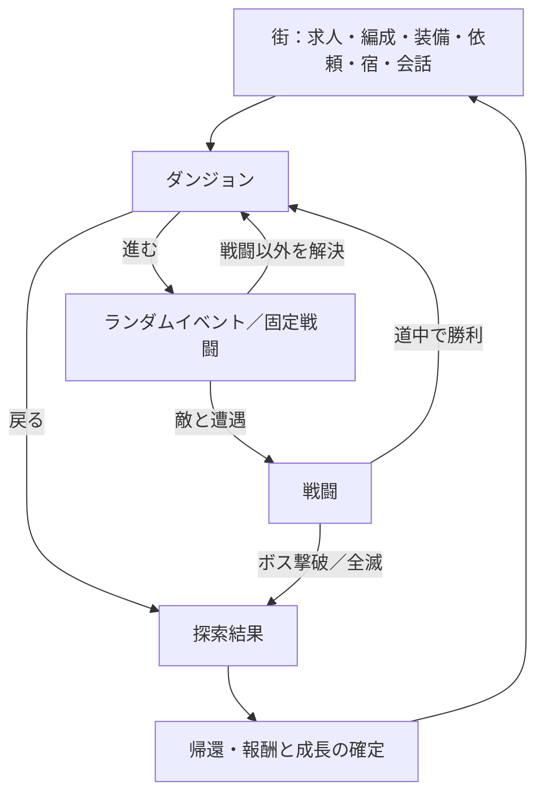

# ゲーム仕様

確定した遊び方と未決定の論点を区別する。実行用データの暫定値を確定仕様へ昇格させない。操作の受入条件は[[features]]、実装の責任分担は[[architecture]]、設定本文とデータの分担は[[concept-data]]を参照する。

## モンスターの攻撃

### 決定

- モンスターの攻撃の内容を先に決め、攻撃の種類ごとに本人の画像を生成して設定する。通常攻撃とワザを区別し、実際に使った攻撃の画像を表示する。
- 同じ動作で威力だけが異なる攻撃は画像を共用する。体当たりと粘液まき、打撃と結晶の雨など、動作が違う攻撃は別画像にする。
- 通常画像の顔・目・体形・手足・殻や翼の比率・模様を固定し、色違いと個体差も本人に合わせる。
- 開発画面でも攻撃名と近接・遠距離を確認できる。[[monster-attacks|画像対応と制作方針]]に従う。

### 未決定

- 攻撃の威力・使用確率・状態異常の最終バランス。現在の数値は暫定値とする。

## 仲間と自分の遊び方

### 決定

- 3人の編成で異なる遊び方を成立させる。タンク、回復、近接・遠距離の火力、強化・妨害に価値を持たせる。
- 特定の仲間を必須にせず、必要な機能に複数の手段を用意する。探索の能力も分岐の選び方に関わる。
- 仲間の総数は固定しない。追加・削減は、編成の楽しさと各キャラの価値を改善できる場合に行う。
- ミミカは影絵の悪魔をモチーフとするNの仲間。武器と防具を固定せず、募集の対象にする。
- クレフはNの仲間で、装備を固定せず防具を着替えられる。
- レア度 R の仲間は悪魔と契約している。悪魔を使った戦いが前提なので、武器も防具も持たない。契約している悪魔とは組で、変更しない。
- Rの契約姿は1人1つとする。役割・ワザ・借りる身体・対価は対象の実行データで管理する。戦闘中に別モードへ切り替える操作は出さない。
- R のモードの絵：リゼはもっと悪魔的にし、胸に鍵穴を描いて鍵は描かない。セラ・ネム・リベットは胸に鍵穴を描く。
- R はトリッキーな役にする。扱いは難しいが、編成の幅を広げる。N より強いわけではない。
- ヒーラーを特定の仲間に頼らせない。N のヒーラーはシオン・ジグ・モートの3人。役割が同じでも戦い方を重ねない（シオン＝即時の大回復・浄化・蘇生、ジグ＝速さで先に動き毒と縛りを解く、モート＝重い防具で前に立ち、殴りながら繕い・起こす、ツムギ＝再生とケイヤク）。
- すべての仲間を差別化し、戦い方が重ならないようにする。

### 未決定

- 各編成の最終的な強さと、探索能力の回数・効果量。実装した暫定値を確定仕様としない。
- ツムギの契約の造形をカイコのような別コンセプトにする案。現在の姿を変更する場合は、設定・実行データ・画像をまとめて見直す。

## 目指す体験

仲間と装備を育て、3人で繰り返し挑戦してダンジョンを突破するローグライト。

探索の判断と報酬・成長の手応えに集中できることを目指す。一歩進んだ先の抽選、戦闘の勝利、掘り出し物の武器、仲間の成長を短い間隔で楽しめることを重視する。欲しい報酬を前に、もう一歩進むか、今の戦利品を持って戻るかを判断する。

着想元はWizardry Variants Daphne。仲間・武器の収集、討伐依頼、ダンジョン、少人数編成、宿、汚れと疲れ、育成、会話という要素を取り入れる。原作の仕組みを全面再現する要件ではなく、この作品の探索テンポに合わせて構成する。

- メインの面白さはダンジョン攻略。ダンジョンへの突入と強化を繰り返す流れを重視する。
- 武器集めを中心的な楽しみにする。武器を拾い、強化し、より深く潜る。
- 周辺機能を増やして出撃までの準備や操作を長くしない。
- スマホを優先し、PCでも遊べる。
- 求人とガラクタ鑑定はゲーム内の獲得手段。現金による課金や有償ガチャは要求されていない。

## 一周の流れ

街では次の挑戦の準備をする。探索では一歩ごとの結果と継続・帰還の判断に集中する。帰還後の収集・育成が次の突破につながる。

## 世界

### 決定

- ダンジョンは底の見えない大渓谷。探索は冒険者の仕事で、下層へ進むほど手に入るアイテムと稼ぎが増える。
- 谷の謎を追う物語は中心に置かない。小さな謎は道具屋ウォルターの扉の1本だけ残す。
- 大渓谷へは街はずれの乗り場から昇降機で降りる。籠（かご）は各層の踊り場まで降り、到達した層は籠が届く深さを表す。線路・列車・駅・汽笛は世界の言葉として使わない。
- 層の名前は 0 結晶の洞窟、1 巨人たちの墓場、2 錆びた鉄橋、3 毒沼の温室、4 底なしの祭壇。巨人は大昔に死んだ骨だけの背景で、巨人の魔物はいない。錆びた鉄橋は谷に昔から架かる古い橋で、昇降機とは別物。
- 街は大渓谷の資源（結晶・骨・素材）で発展している。
- 4層（底なしの祭壇）より先はまだ未開拓。籠も4層の踊り場までしか降りない。
- プレイヤー（悪魔召喚師）は悪魔のロクスに借りがあり、ロクスをダンジョンの最奥へ連れて行ってあげたい。これが物語の軸。
- ロクスとの間に約束がある感じ、過去に何かあったのだろうという気配を匂わせる程度でよい。過去の出来事・約束の中身・エンディング・最奥での結果は書かない。
- 冒険者はみんな労働者。ダンジョンへ行くのは労働のため、お金のため。でも、みんなそれぞれの想いを持っている。仲間ごとに想いを持たせ、稼ぐ理由や使い道ににじませる。
- 世界観の詳細は [[concept/README|設定資料]] の世界を正とする。
- 設定と文章のトーンは、世界は普通で、人間たちの物語が切ない。人は大事なもののために生きている。エモくて切ない。個性的だが、仲良くしたいと思えないほどの人物は作らない。性的すぎる表現はなし。狂気・生贄・グロテスクさは使ってよい。書き方は [[writing-tone|設定と文章のトーン]]。

### 未決定

- 周辺拠点ごとの独立したダンジョン内容・地図の最終的な広さ。現在は既存の層への入口を配置する。
- ロクスへの借りの中身、ロクスと過去に出会った経緯（ゲーム開始時から契約済み）。最奥に何があるかと結末は書かない方針。
- 物語の背骨を「帰還」に置く案（昇降機番ロイドが頭数を数え、籠は最後の一人が戻るまで待つ）。制作案で、確定ではない。

## ワールドマップ

現在は機能・データ・画面を保持し、ゲーム内の入口と保存からの自動再開は無効にする。

### 決定

- ダンジョンとは別に、上下左右へグリッドのマスを移動する地図を持つ。0層突破後に周辺の街・村へ出られる。
- 村で情報を聞いたり、依頼を進めたりすると、未表示の道や目的地が現れる。
- 拠点にはダンジョンの入口も置く。仲間の契約に必要な素材を別のバイオームへ探しに行く。
- 一度訪れた拠点へはすぐ移動できる。

## 探索

### 決定

- 移動は「進む」「戻る」を基本にする。分岐では行き先を選んで進む。ダンジョン内はこの方式を保ち、ワールドマップのグリッド歩行と分ける。
- 分岐は合流させず、どんどん分かれていく。分岐は当たり前のことなので、分岐で文字の演出は出さない。
- 分岐は報酬と危険を比較して悩めるものにする。現在の体力・編成・欲しい装備やスキルによって、選ぶ価値が変わるハクスラを目指す。
- 探索中は状況を考えて選び続けられることを重視する。魔物のショップや取引も選択肢に含める。「？」の道、危険度、痕跡などの手掛かりを見せ、全てを事前に明かさずにリスクを判断できるようにする。
- 進むたびにランダムイベントを抽選する。節目には固定戦闘を置く。
- ダンジョン（各層）は16地点。8地点目に中ボス、終点にボス。層の中は谷の岩棚や古い足場・吊り橋・洞窟の道などをたどる。
- 最後の層のボスを倒すとクリアになり、エンディングの場面を出す。その後も遊べる。

### 未決定

- イベントの種類と抽選、ダンジョンの数と長さ。

## パーティと戦闘

### 決定

- 最初からプレイヤーを含む3人グループ。初期の仲間はアルダ（タンク）・モート（ヒーラー）。会話で関係と守り・攻撃・回復の役割を伝える。プレイヤー自身は外せない。既存保存の仲間は強制変更しない。
- 戦闘に出るのは3人。狭い場所で連携できるのは3人まで、という理由づけ。テンポを上げ、1人ずつの出番を増やす。4人で出撃していた古い保存は、読み込むときに並びの右の仲間を控えへ回して3人にする。
- 並びの左2人が前衛、右1人が後衛。後衛も攻撃できる。攻撃とスキルは近接か遠距離に分かれ、後衛から近接で攻撃すると被害は半分。
- タンクが機能する狙いにする。敵の近接は前衛にしか届かず（前衛が全員倒れたら後衛へ）、前衛のタンクは狙われやすい。敵の遠距離は後衛にも届くが、後衛には当たりにくい（外れると「外れた」と出る）。
- 毎ターン生存者ごとに指示を選び、1行動ごとに1つの結果を見せる。
- 通常攻撃はなくし、スキルから選んで戦う。武器の3つとダンジョンスキル「祝福」1つで4枠にする。キャラ固有・悪魔スキルは、この4枠とは別のメニューで残す。
- スキルごとに使用回数を持ち、宿で回復する。武器を強化すると最大の使用回数が増える。
- 使用回数が尽きたら、使用回数を使わない弱い攻撃「殴る」を選べる。攻撃できるスキルが残っている間は出さない。
- 画面では残りの使用回数を「残り 3/5」と見せる。
- 戦闘の指示に「防御」を残す。防御は使用回数を使わない。
- 味方ひとりに使う回復などは、下の仲間の札から「これ」で選ぶ。戦闘中はバッグを出さない。
- 物理と魔法で耐性を分けない。火でも刃でも同じダメージとして、防具の耐久とHP（生命力）から減る。

### 未決定

- 「殴る」で自分の防具を傷める案（防具の耐久と合わせて決める）。暫定では「殴る」で自分の防具は傷まない。
- 敵の行動、難易度。
- 状態異常をどこまで扱うか。
- タンクの狙われやすさ（暫定は前衛の他の仲間の3倍）と、敵の遠距離が後衛に当たる確率（暫定60%）。
- 3人編成の続きの案。
  - 1人がロールを最大2つ持つ。プレイヤーは悪魔を切り替えてロールを変える（全員か1人ずつか、戦闘中に切り替えられるか、切り替えに行動を使うかは未決定）。
  - ダンジョンには6人まで連れて行き、戦闘以外のシーンならいつでも入れ替えられる。戦闘中は入れ替えない。入れ替えを促す確認は出さず、一手で替えられるようにする。控えにも戦闘以外の出番（罠・鑑定・会話など）と経験値を少し持たせる案がある。
  - パーティをセットで保存し、出撃や入れ替えで選ぶ。範囲攻撃で周回が楽、単体火力でボス向きなど、目的ごとのビルドを組む。
  - 層ごとの個性（打撃が有利、魔法が半減など）とクエストの目的で強い構成を変える。完全な無効は敵1種類か節目の戦闘にとどめ、出撃前に分かるようにする。上の「物理と魔法で耐性を分けない」と食い違うので、採用するときに決め直す。
  - 仲間ごとにロールの組み合わせ・成長の伸び方を変え、育てたくなる個性にする。

## ステータス

### 決定

- ステータスは筋力と技量の2つ。武器ごとに必要な筋力・技量があり、足りなくても装備はできるが弱くなる。条件を上回っても攻撃力は上がらない。成長すると、より強い武器を扱えるようになる。
- HP（生命力）はキャラごとに個人差を持たせ、128を基準とする。レベルが上がるとHP・筋力・技量が伸び、速さは確率で伸びる。
- MPはなくす。スキルは使用回数で管理する。
- 敵も防御値を持たない。敵の硬さはHPで表し、敵の攻撃は「攻撃力 × 威力 × 振れ幅」で味方のHPを削る。
- 表記は「HP（生命力）」のように略語と日本語を併記する。

### 未決定

- クリティカル率の決め方。キャラ固有の値と武器の重さで決める案がある。
- 速さが行動順以外に効くか。

## 武器

### 決定

- 武器は筋力系と技量系に分ける。武器種は両手剣・片手剣・斧（筋力系）と、魔法銃・短剣（技量系）。弓と杖は作らない。
- 攻撃力と使えるスキルは武器ごとに決まる。魔法も武器（魔法銃、短剣など）から使う。
- 武器には職業制限を付けず、誰でもどの武器でも装備できる。武器の違いは立ち絵には反映しない。
- キャラごとに得意な武器種があり、得意な武器では攻撃力が上がる。得意でない武器も装備できるが弱い。
- 武器を装備していないときは、得意な武器種に合わせたデフォルトの武器（アルダならボロボロの両手剣、マユなら錆びた魔法銃）で戦う。デフォルトの武器は持ち物にならず、売れない。
- 武器ごとにスキルが3つ付く。1つはその武器の固有スキル、残り2つは入手時から付いているランダムなスキルとする。
- ダンジョンで拾う武器は全て未鑑定。「だれかの片手剣」などの表示にし、武器屋で鑑定するまで正体・能力・強化値・ワザは分からず装備できない。
- 拾った武器は、冒険者が武器屋で買って鍛え、命を落としたり落としたりして残ったもの。鑑定で前の持ち主の強化が判明する。同じ個体を調べるので、鑑定で再抽選しない。
- ガラクタの鑑定、店での購入もできる。店の商品は鑑定済み。鍛冶屋で強化できる。
- 同じ武器でも個体ごとにレア度と使い勝手が変わる。レア度はN・R・SRの3段階。
- 武器の強さは武器ごとの固定値を基本とし、ドロップ時にランダムで固定値より強い個体が出てよい。
- 武器の固有スキル1枠は固定。ランダムな2枠は、スキルの書があれば鍛冶屋で変更できる。
- レア度 R の仲間は武器も防具も持たない。攻撃は本人の契約に対応するワザで決まる。
- 装備の収集量を増やし、探索で得る武器と、同じ進行段階で選び分けられる防具を追加する。具体的な種類数・性能・解放条件は暫定ルールで管理する。

### 未決定

- ランダム2枠の抽選候補と、レア度による候補・性能の違い。枠数はレア度によらず2枠とする。
- スキルの書の入手方法、対応するスキル、変更時の消費と費用。
- レア度ごとの攻撃力の上振れ幅。暫定の値は [[decisions/002-foundation-rules|暫定ルール]]。
- 前の持ち主が付けた強化の分布、武器ドロップ率の最終値。

## ダンジョンスキル「祝福」

### 決定

- 祝福はダンジョン内でしか手に入らないスキル。武器の3枠とは別に、各キャラが1枠持つ。
- 獲得時に、誰に持たせるかを選ぶ。選んだキャラにすでに祝福がある場合は、その祝福を上書きする。枠は増えない。

### 未決定

- 祝福の出現頻度、種類、使用回数と回復方法。
- 帰還・全滅時に祝福を失うか、次の探索にも持ち越すか。

## 防具

### 決定

- 防具は耐久ゲージを持ち、HP（生命力）のバーにつなげて表示する。受けたダメージは防具の耐久から先に減る。
- 受けるダメージを減らす防御値は持たない。
- 防具の耐久は自然には回復せず、お金を払って修理する。キャラ固有のスキルで防具を修復できるキャラもいてよい（シオンの「防具の修復」）。
- 防具は一式で、一人が着けられるのは一つ。兜・盾のような部位は作らない。盾は武器と一式として扱う（片手剣と盾など）。
- 防具には職業ごとの装備制限を設ける。どの職業も各階層で防具を更新できるようにし、耐久・速さ・技量の選択肢を分ける。性別による制限は付けない。
- 仲間の立ち絵は上半身に統一し、装備した防具に合わせて変える。元の上半身画像を顔・体格の基準に、既存の装備別全身画像から腰より上を描き直す。単なる切り抜き拡大は使わない。同じ人物では頭の大きさと肩の高さを揃え、ポーズ・頭の向き・表情は少し変えてよい。武器は画像に反映しない。着替えの対象はレア度 N の仲間。R の服装は防具ではなく「ケイヤク」のモードで変わる。防具を変更できない固定装備の仲間は既存の固定装備の上半身を使う。

### 未決定

- 防具の耐久が尽きたあとの扱い。暫定では耐久0でも防具は外れず、被害はすべてHP（生命力）へ届く。
- 毒・罠のような、敵の攻撃以外の被害を防具で受けるか。暫定ではどちらもHPから直に減る。

## 魔法

### 決定

- 魔法は信仰ごとに流派がある。悪魔の信仰と、自然の信仰（星、大地、太陽、植物など）。仲間ごとに使える流派を決める。詳細は [[concept/world/world-magic|魔法の流派]]。

### 未決定

- 流派ごとの効果・得意分野。暫定の割り当てと数値は [[decisions/002-foundation-rules|暫定ルール]]。

## 仲間と育成

### 決定

- 仲間は求人で集める。お金を払うとランダムで枠を引き直せる。枠は引き直すまで残り、いつでも契約できる。契約済みの者は「契約済み」で契約できない。SRなど珍しい者は出現率がかなり低い。
- キャラクターの合成は行わない。
- 職業は着られる防具を決める。得意な武器や使える魔法はキャラごとに決める。
- 仲間ごとに成長の型（序盤・中盤・終盤の伸び方）を持たせる。設定資料の `growth_intent` を実行用データの成長の型に対応づける。画面ではキャラのステータスに型を出す。
- レア度は強さではなく、効果の珍しさ・トリッキーさの違いにする。SRでも強くする必要はなく、効果がうれしいだけでよい。
- みんな個性を出し、ビルドや構成次第で同じ強さにする。能力自体は弱くても、構成で強くなる仲間がいてよい。構成はタンク・ヒール・ダメージを基本にする。
- ユニークは装備を変更できない代わりに固有の武器を持つ（強さの上乗せではない）。固有の武器は、拾った武器を素材にして鍛冶屋で強化する。
- 契約した悪魔のワザには専用の画像演出を持たせる。画像があることを、独立した必殺技システムの実装と同一視しない。
- Rの仲間は共通防具へ着替えず、本人の契約姿を使う。契約の造形は[[image-generation#Rの契約モードと片目のモザイク]]に従う。
- 契約姿の豪華さをレア度や強さの順位にしない。胸の契約印と目元は本人固有の指定を守り、造形から未定義の能力を推定しない。
- 仲間と話す機会を持ち、収集した個体への愛着を育てる。
- 仲間とは最初は一緒に仕事する同僚の距離で、近くない。一緒にダンジョンへ行く・宿に泊まるなどで少しずつ親しくなり、仲良くなると見える会話が増える。距離が縮まったことは会話の内容（話題・口調）でわかるようにする。
- 所持キャラと進行度で会話を変える。宿の雑談、宝箱、分岐、アイテム入手にも会話を用意する。
- 街の住人との会話を増やし、住人の来歴・暮らし・住人どうしの関係がわかるようにする。会話の選択でフラグを大量に立て、後の会話が変わる。
- 場所に入ったときにフラグやランダムで場面（ムービー）が始まる。住人は自分の店以外の場所にも現れ、街で暮らしている感じを出す。
- 1人で話す会話も一言で終わらせず、2回は「次へ」を押す長さにする。プレイヤーが答えを選び、軽い会話を楽しめるようにする。
- 実行用の会話パターンをdevで確認する。背景設定は資料に残し、devへ配信しない。会話条件と台本の確認方法は[[dev-studio]]に従う。

### 未決定

- 成長の型の具体的な数値、求人の個体差、ユニークの加入経路。
- R の必殺技の内容（どのワザを必殺技にするか、威力・回数）、専用イラストの演出の仕方。
- 個々の台本・追加する人物背景の確定、親交の恩恵、会話の頻度。制作案と確定設定を区別する。

## 主人公と悪魔

### 決定

- プレイヤーは悪魔召喚師。外見は複数の候補から好みで選ぶ。プレイヤー本人に固定のセリフは持たせない。
- プレイヤー本人は防具を装備せず、レベルや経験値による固有の能力成長もしない。戦う力は契約した悪魔から得る。仲間の育成と防具は継続する。
- プレイヤーの着せ替えは見た目だけで、能力・耐久・所持金に影響しない。既存の衣装画像を使う。
- 最初の悪魔はロクス。開始時から所持・契約済みで、召喚操作や召喚石の消費は不要。追加の悪魔は物語で契約書を入手し、召喚して会話する。悪魔が求める素材（金のリンゴなど）を別のバイオームで手に入れ、契約料と一緒に渡すと仲間になる。召喚済みの相手との再会は契約書を消費しない。
- ロクスはヒロインのように身近な相棒として扱い、日常と探索の会話を多く持たせる。街から直接話しかけられ、返答を選べる。既存の口調を保ち、進行に合わせて二人の関係を描く。
- はじめから遊ぶと、街の外の夜の森の焚き火で短い開幕の場面（ムービー）を流す。まだ登録前でダンジョンに入れないこと、街のギルドで登録することを伝えてから街へ着く。
- 名前と容姿はギルドの受付で登録する。受付嬢が「ここに記入して」と登録用紙を差し出し、用紙に名前を書き、貼る写真として容姿を選ぶ。名前は全角カタカナ（長音「ー」を含む）1〜6文字。容姿は後から変更できる。登録が済むと、仲間が「これでやっとダンジョンに行ける」と話し、ミレナのダンジョンの案内へつなぐ。
- 開始時から3人おり、初回はギルドで名前を登録して出撃へ案内する。お店・ギルド・初めての場所には一度だけ立ち絵のチュートリアルを出す。
- 悪魔（ロクスを含む）はプレイヤーとしか話さない。悪魔が出る会話は悪魔とプレイヤーの2者だけにし、仲間・住人と同じ場面に悪魔を出さない。
- 会話で画面に同時に出す立ち絵は最大2人。3人目が話すときは、誰かが退場してから入れ替わる。
- 悪魔のガチャとSSR・SRなどのレア度は廃止。強さの上下で集めるのではなく、それぞれの人物・ワザ・役割を大切にする。出会いの会話を読んだ後、素材と契約料を払えば確実に契約できる。
- 悪魔は一人ずつ仲間になり、見送り・重複・合成はない。全員に日常会話と親しくなる会話を持たせる。違う会話を重ねて仲良くなる。同じ会話の連打や、返答の正解探しを要求しない。親しさは会話や物語を進めるために使い、戦闘能力を増減させない。
- ヌイとザザは友達。同じ縫い針の意匠を使い、赤い糸と影という違いを持つ。二人で話す場面は制作案で、悪魔とプレイヤーの二者会話という制約との両立は未決定。
- 戦闘ではプレイヤーが契約した悪魔と合体して戦う。ワザの演出は悪魔の立ち絵を見せる。合体の効果と、悪魔の流派による仲間との相性を持つ。

## 街と経済

### 決定

- 武器と防具の店はオットーひとり。鍛冶屋は別の店で、ヒルデが武器と防具を強化・生産する。
- ホームは左に大きなギルドを置き、中央の道は奥へ通す。道の先の右寄りに、旅に出る門が街並みの一部として見えればよい。門を画面に無理に入れず、まともな街並みにする。奥の店は個別の選択肢に見えない控えめな背景にする。施設の入口から出る吹き出しで移動する。ダンジョンへは門の位置の「ダンジョン」の吹き出しから行き、右下のダンジョンボタンは廃止する。商店街は大通りを占めず、街並みの一角から市場へ続く脇道として見せる。名前を登録する前はダンジョンへ行けない。最初はギルドの受付で名前を登録する。
- ホームは夜景にし、魚眼レンズのように建物や石畳がせり出すダイナミックな構図にする。ギルドは酒場として描き、建築の格好よさを重視する。
- 宿屋はギルドの中に入れる。街の右は宿屋をやめ、ダンジョンへの門にする。ギルドの中に受付があり、受付を押すと受付の画像に移る。ギルドの中の宿屋にも、画像と位置が一致するボタンを置く。
- 宿は回復の拠点。汚れと疲れも扱い、再出撃につなげる。
- 敵の討伐を目的とする依頼を用意する。
- 街や農場の討伐もギルドのクエストで扱い、依頼からすぐ戦う単発戦闘を用意する。ムービーや探索移動を挟まず、短い一戦で決着する。
- 稼いだお金は防具の修理、武器の強化、求人の引き直しなどに使う。

### 未決定

- 疲れ・汚れの効果、回復手段と費用、報酬の量。
- 防具の修理の値段。暫定では「減った耐久 × `balance.armor.repairPerPoint`」で、鍛冶屋で一人ずつか「全部直す」で払う。

## 失敗と継続

### 決定

- 倒れた仲間が死んで戻らない、といった重い損失は入れない。

### 未決定

- 全滅時に何を失うか。暫定では「その探索で得たお金とアイテムを失い、経験値は残す」で実装している（[[decisions/002-foundation-rules|暫定ルール]]）。最終の損失はまだ決めていない。
- エンディングの内容（文章・絵・踏破後の遊び）。暫定では短い文章の板だけを出す。
- 永続する成長と、挑戦中だけの成長の区分。

## バランス

- 最初はダンジョン（0層）を突破できないくらいにする。育てて突破する。目標と測り方は [[builder/targets.ts]]。

## 画面の文字

- 画面の文字は日本語。日本語と意味が重なる英語の飾り（SUMMON! など）は入れない。ステータスの略語は「HP（生命力）」のように併記する。
